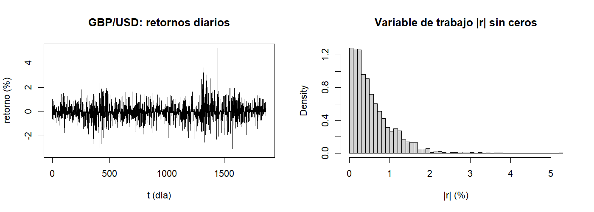
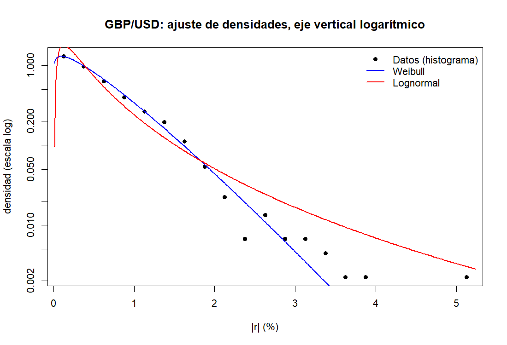
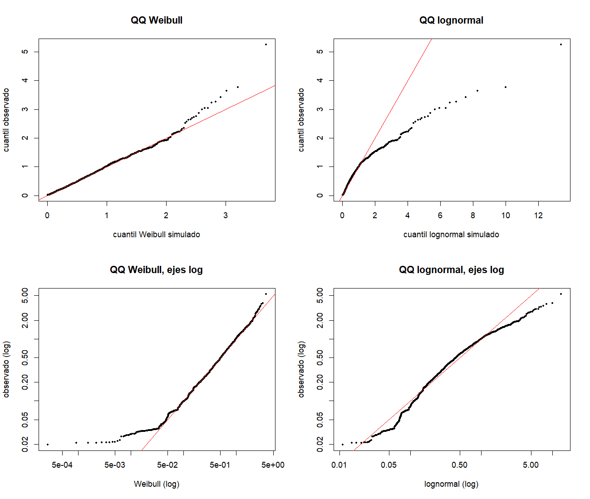
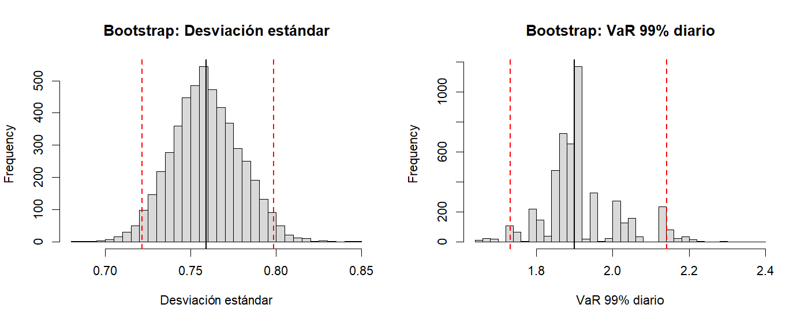

```{r setup, include=FALSE}
knitr::opts_chunk$set(echo = FALSE, message = FALSE, warning = FALSE,
                      fig.align = "center", out.width = "92%")
# Todos los números del texto salen de los datos y de los resultados guardados por los scripts 01-06.
archivo <- "retornos_diarios_12_series.csv"
cand <- c(file.path("data", archivo), archivo)
ruta <- cand[file.exists(cand)][1]
datos <- read.csv(ruta, stringsAsFactors = FALSE, encoding = "UTF-8")
gbp <- datos[datos$serie == "GBP/USD", ]; gbp <- gbp[order(gbp$t), ]
r <- gbp$retorno_pct; n <- length(r)
n0 <- sum(r == 0); x <- abs(r[r != 0]); m <- length(x)
pA <- readRDS("resultados/params_A.rds")
vA <- readRDS("resultados/validacion_A.rds")
b1 <- readRDS("resultados/B1.rds")
b2 <- readRDS("resultados/B2.rds")
f <- function(v, d = 4) formatC(v, format = "f", digits = d)
m2 <- mean((r - mean(r))^2)
asim <- mean((r - mean(r))^3) / m2^1.5
curt <- mean((r - mean(r))^4) / m2^2 - 3
```

# Introducción y datos

El proyecto estudia cuánto puede perderse en un día o en una semana al mantener un activo y qué tan confiable es esa cifra. Nuestro grupo trabaja con la serie del tipo de cambio **GBP/USD**, a partir del archivo `retornos_diarios_12_series.csv` entregado por la docente. Según la guía, la serie cubre del 2 de enero de 1980 al 21 de mayo de 1987 y su retorno diario es $100\,(\ln P_t-\ln P_{t-1})$, en porcentaje. El archivo no trae fechas, solo el número de día $t$; el período se toma de la guía. Se usan exclusivamente las `r n` observaciones de `GBP/USD`, que coinciden con las 1.866 que indica la guía, con $t$ consecutivo de 1 a `r n` y sin valores faltantes.

Los retornos tienen media `r f(mean(r))` y desviación estándar `r f(sd(r))`; su asimetría es `r f(asim)` y su curtosis en exceso es `r f(curt)`, lo que indica colas más pesadas que las de una normal. La Figura 1 muestra que los movimientos grandes tienden a agruparse en rachas, una señal de volatilidad agrupada que condiciona los supuestos de independencia de los métodos posteriores.

**Tratamiento de los ceros.** `r n0` retornos valen exactamente cero (`r f(100*n0/n, 3)` % de la serie). Las distribuciones Weibull y lognormal solo admiten valores estrictamente positivos, de modo que la Fase A se construye sobre $x_i=|r_i|$ para los $r_i\neq 0$, que son `r m` datos. Se excluyen solo para la Fase A. En B2 se usan los retornos originales completos, con los ceros. La consecuencia es que el modelo ajustado nunca produce un retorno exactamente cero, mientras que en los datos ocurre en el `r f(100*n0/n, 1)` % de los días. Esto es una limitación del modelo.

Además, el menor $|r|$ no nulo es `r f(min(x))`, y bajo la Weibull ajustada se esperarían unos `r round(m*(1-exp(-(min(x)/pA$lam_w)^pA$k_w)))` valores por debajo de ese mínimo, pero no hay ninguno. Esto es compatible con que los precios originales estén registrados en pasos discretos y que los movimientos muy pequeños figuren como cero; es solo una hipótesis, que no podemos verificar con los archivos disponibles.

```{r fig1, fig.cap="Retornos diarios de GBP/USD (izquierda) y variable de trabajo |r| sin ceros (derecha)."}

```

# Fase A: simulación y generación de variables

## Estimación por máxima verosimilitud

Se ajustaron por máxima verosimilitud, con implementación propia, la lognormal (solución cerrada: $\hat\mu=\overline{\ln x}$, $\hat\sigma^2=\overline{(\ln x-\hat\mu)^2}$) y la Weibull de forma $k$ y escala $\lambda$. Para la Weibull, $\hat\lambda^k=\overline{x^k}$ y la forma $\hat k$ es la raíz de
$$g(k)=\frac{\sum x_i^k\ln x_i}{\sum x_i^k}-\frac1k-\overline{\ln x}=0,$$
que se resolvió con el método de Newton. Como $g'(k)>0$ para todo $k>0$, la raíz es única. Newton convergió en pocas iteraciones desde varios valores iniciales. Como comprobación, `MASS::fitdistr` (solo verificación) coincide con nuestros parámetros hasta la quinta cifra decimal en la Weibull.

```{r tabA}
tabA <- data.frame(
  Familia = c("Lognormal", "Weibull"),
  Parametros = c(sprintf("mu = %s, sigma = %s", f(pA$mu_ln), f(pA$sigma_ln)),
                 sprintf("k = %s, lambda = %s", f(pA$k_w), f(pA$lam_w))),
  logLik = c(pA$ll_ln, pA$ll_w), AIC = c(pA$aic_ln, pA$aic_w))
knitr::kable(tabA, digits = 2, col.names = c("Familia", "Parámetros", "Log-verosimilitud", "AIC"),
             caption = "Parámetros estimados por máxima verosimilitud y AIC (m = 1791).")
```

La Weibull tiene un AIC menor en `r f(pA$aic_ln - pA$aic_w, 1)` unidades con el mismo número de parámetros, por lo que es la familia elegida para el resto del proyecto. Una forma $\hat k\approx1.14$, cercana a 1, implica una densidad que no cae a cero en el origen, como se observa en los datos (Figura 2).

## Generación y validación

La Weibull se simula por transformada inversa, $X=\lambda[-\ln U]^{1/k}$, y la lognormal con una normal estándar generada por Box-Muller, $X=\exp(\mu+\sigma Z)$ con $Z=\sqrt{-2\ln U_1}\cos(2\pi U_2)$. Solo se usa el generador uniforme base. Se comprobó que $F(X)$ es uniforme en la muestra Weibull y que Box-Muller reproduce media 0 y varianza 1 con muestras grandes. Para validar, se generó una muestra sintética 20 veces mayor que la real ($N=`r 20*m`$) por familia.

```{r fig2, fig.cap="Ajuste de las densidades con eje vertical logarítmico. Cada punto aislado en la cola corresponde a muy pocas observaciones."}

```

```{r fig3, fig.cap="Gráficos cuantil-cuantil: cuantiles observados frente a cuantiles de las muestras sintéticas (fila inferior: ejes logarítmicos)."}

```

```{r tabq}
tq <- vA$tabla_q
tq$p <- paste0(100 * tq$p, " %")
knitr::kable(tq, digits = 4,
  col.names = c("Cuantil", "Observado", "Weibull simulada", "Weibull teórica", "Lognormal simulada"),
  caption = "Cuantiles 50, 90 y 99 de |r|.")
```

La distancia de Kolmogorov-Smirnov, calculada manualmente entre la muestra observada y la sintética, es `r f(vA$D_w)` para la Weibull y `r f(vA$D_l)` para la lognormal (frente a la teórica, `r f(vA$D1_w)` y `r f(vA$D1_l)`). Como los parámetros se estimaron con los mismos datos, estos valores se interpretan como medidas de distancia y no como un contraste formal.

```{r cola}
q_t <- function(p) pA$lam_w * (-log(1 - p))^(1 / pA$k_w)
pp <- c(0.99, 0.995, 0.999)
cola <- data.frame(p = paste0(100 * pp, " %"), valor = q_t(pp),
                   obs = sapply(pp, function(p) sum(x > q_t(p))), esp = m * (1 - pp))
knitr::kable(cola, digits = c(0, 3, 0, 1),
  col.names = c("Cuantil de la Weibull", "Valor", "Datos que lo superan", "Esperados si el modelo fuera exacto"),
  caption = "Excedencias de la cola bajo el modelo Weibull.")
```

**Interpretación.** La Weibull sigue de cerca a los datos en el centro y hasta el cuantil 99 %, mientras que la lognormal, aunque tiene la cola teórica más pesada, la **sobreestima** con fuerza: su cuantil 99 % simulado es `r f(vA$tabla_q$lognormal_sint[3], 2)` frente a `r f(vA$tabla_q$observado[3], 2)` observado. Por otro lado, la Weibull subestima algo el extremo de la cola: en el último 0.5 % de los días hay más excedencias de las esperadas (Tabla 3), y el mayor retorno absoluto observado, `r f(max(x), 2)`, es muy poco probable bajo el modelo. Esto es relevante para el evento raro de B1.

**Retornos con signo.** Para simular retornos con signo se asigna $+$ o $-$ con probabilidad 1/2, independiente de la magnitud. Es un supuesto del modelo (simetría y signos independientes), no una propiedad demostrada de los datos: en la muestra hay `r sum(r>0)` retornos positivos y `r sum(r<0)` negativos.

# Fase B: integración y remuestreo (avance)

## B1: Monte Carlo y muestreo por importancia

Se estima $p=P(S_5>u)$, donde $S_5$ es la pérdida acumulada de 5 días consecutivos bajo el modelo de la Fase A (pérdidas diarias $s_jX_j$ independientes, con $X_j\sim$ Weibull y signos $\pm1$ equiprobables). Con una simulación de referencia de $4\times10^6$ réplicas se eligió $u=`r b1$u`$, el cuantil 99.9 % de $S_5$ redondeado, de modo que $p\approx0.1$ %. Una segunda simulación independiente de $4\times10^6$ réplicas da $p=`r f(b1$p_ref, 6)`$ (error estándar `r f(b1$se_ref, 6)`).

La propuesta de muestreo por importancia genera cada $X_j\sim$ Weibull$(k,\,c\lambda)$ con $c=`r b1$c_is`$ y declara un día como de pérdida con probabilidad $q=`r b1$q_is`$ en vez de 1/2. El peso es $W=\prod_{j=1}^5 c^{k}\exp\{-(x_j/\lambda)^k+(x_j/(c\lambda))^k\}\,(0.5/q)^{N_p}(0.5/(1-q))^{5-N_p}$, con $N_p$ el número de días de pérdida. El estimador es el promedio de $\mathbf 1\{S_5>u\}W$, insesgado porque $E_g[\mathbf 1\{S_5>u\}W]=p$. Los parámetros $(c,q)$ se eligieron con un piloto sobre una rejilla de propuestas.

```{r tabB1}
res <- b1$res
res$metodo <- c("Monte Carlo simple", "Muestreo por importancia", "Referencia (4e6)")
knitr::kable(res, digits = c(0, 6, 7),
  col.names = c("Método", "Estimación de p", "Error estándar"),
  caption = sprintf("Estimación de P(pérdida a 5 días > %s) con N = %d simulaciones por método.", b1$u, b1$N))
razon <- (res$error_estandar[1] / res$error_estandar[2])^2
```

La reducción de varianza lograda es de `r f(razon, 1)` veces: el muestreo por importancia con $N=`r b1$N`$ equivale a un Monte Carlo simple de unos `r format(round(razon * b1$N, -4), big.mark=".")` simulaciones. Ambas estimaciones son compatibles con la referencia (a menos de un error estándar de diferencia combinada).

```{r pil}
pil <- subset(b1$piloto, q %in% c(0.5, 0.85) & c %in% c(0.7, 1, 2, 4, 8))
knitr::kable(pil, digits = c(2, 2, 6, 2), row.names = FALSE,
  col.names = c("c", "q", "Estimación", "Var MC / Var IS"),
  caption = "Piloto de propuestas. Un cociente menor que 1 indica que la propuesta aumenta la varianza.")
```

El piloto ilustra por qué la propuesta debe elegirse con cuidado: con $c=0.7$ la varianza es mucho mayor que la del Monte Carlo simple, y con $c=8$ el cociente también cae por debajo de 1 (pesos muy dispersos). Limitación: el modelo supone días independientes, lo que contradice la volatilidad agrupada observada, y la Weibull subestima el extremo de la cola; la probabilidad real de una racha de pérdidas podría ser mayor que la del modelo.

## B2: bootstrap percentil (avance)

Sobre los retornos originales, con los `r n0` ceros incluidos, se estudian la desviación estándar y el VaR al 99 % diario (cuantil 99 % de $-r$). Se usaron $B=`r b2$B`$ réplicas con remuestreo con reemplazo programado a mano, y el intervalo percentil del 95 % toma los cuantiles 2.5 % y 97.5 % de las réplicas.

```{r tabB2}
t2 <- b2$tabla
knitr::kable(t2, digits = 4, row.names = FALSE,
  col.names = c("Estadístico", "Estimación", "Sesgo bootstrap", "EE bootstrap", "IC 95 % inf.", "IC 95 % sup."),
  caption = "Bootstrap percentil (B = 5000) sobre los retornos originales.")
```

```{r fig4, fig.cap="Distribución bootstrap de la desviación estándar y del VaR 99 %. La línea negra es la estimación original y las rojas, el intervalo percentil."}

```

La desviación estándar es estimada con un error relativo de `r f(100*t2$EE_boot[1]/t2$estimacion[1], 1)` %, y su distribución bootstrap es suave y casi simétrica. El VaR al 99 % es mucho menos preciso (error relativo `r f(100*t2$EE_boot[2]/t2$estimacion[2], 1)` %), porque depende de las pocas pérdidas de la cola, y su distribución bootstrap es irregular: el cuantil de una remuestra solo puede tomar valores próximos a las pérdidas observadas más grandes, entre las que hay huecos. El sesgo bootstrap es pequeño frente al error estándar en ambos casos. Como el remuestreo ordinario supone observaciones independientes, estos intervalos pueden ser demasiado optimistas si la volatilidad agrupada es fuerte. El jackknife, el intervalo BCa y los intervalos asintóticos se desarrollarán en la entrega final.

# Referencias

- Arel-Bundock, V. *Rdatasets*. https://github.com/vincentarelbundock/Rdatasets (origen de los datos, según la guía del proyecto).
- Paquete de R `Ecdat` (divisas): [PENDIENTE: completar autor, año y versión con `citation("Ecdat")`, y la referencia original del conjunto `Garch` que aparece en `?Garch`].
- Nieto Gil, Y. (2026). *Guía del proyecto final, Computación Estadística 2026-II*. Universidad Nacional de Colombia.

# Nota de transparencia sobre el uso de inteligencia artificial

[REVISAR y ajustar por el grupo antes de entregar.]

- **Herramienta:** Claude (Anthropic), modelo Claude Sonnet 5.5, usado en octubre de 2026.
- **Propósito:** explicar los conceptos y fórmulas de cada método, proponer y depurar los scripts en R, y estructurar este documento.
- **Fases:** Fase A, B1 y B2 (avance).
- **Verificación:** todos los scripts fueron ejecutados por el grupo en R; los resultados se compararon con valores de referencia (por ejemplo, `MASS::fitdistr` solo como verificación, simulación de referencia en B1) y las cifras de este documento se leen de los archivos generados por el código. [Indicar qué parte del código y del análisis es producto propio del grupo.]

\newpage

# Anexo: código

```{r anexo, results='asis'}
for (s in c("funciones_A.R", "01_datos.R", "02_mle.R", "03_generadores.R", "04_validacion.R",
            "05_B1.R", "06_B2.R", "run_all.R")) {
  if (file.exists(s)) {
    cat("\n## ", s, "\n\n```r\n", paste(readLines(s, warn = FALSE), collapse = "\n"), "\n```\n", sep = "")
  }
}
```
