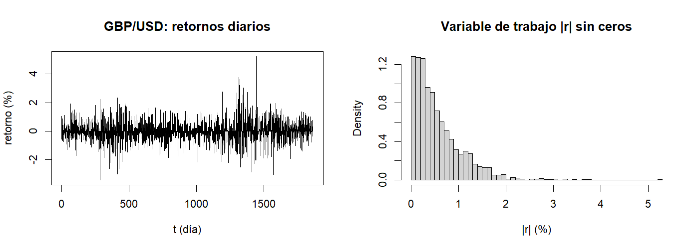
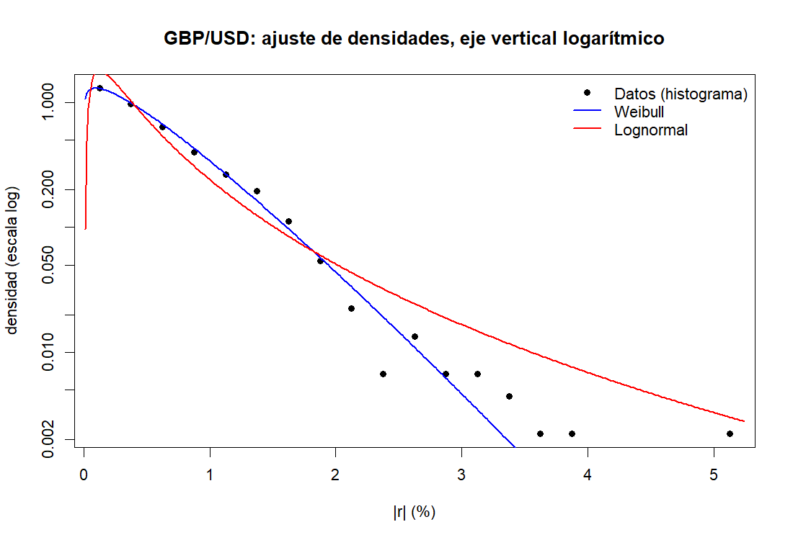
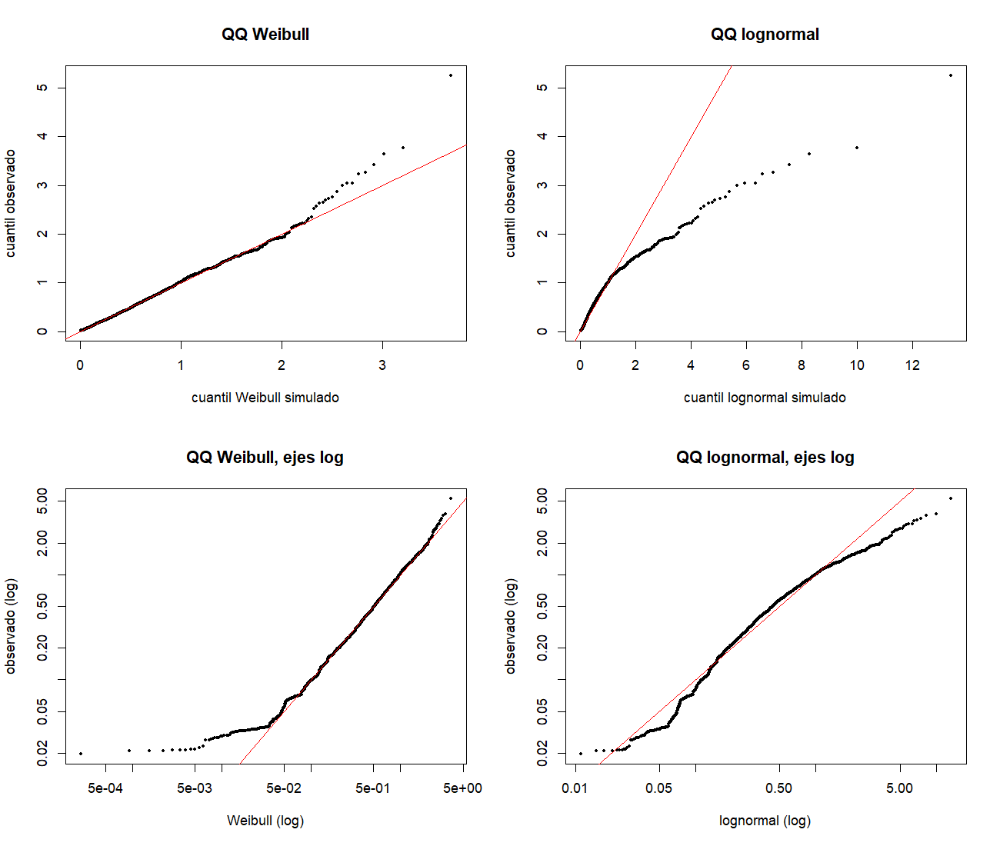
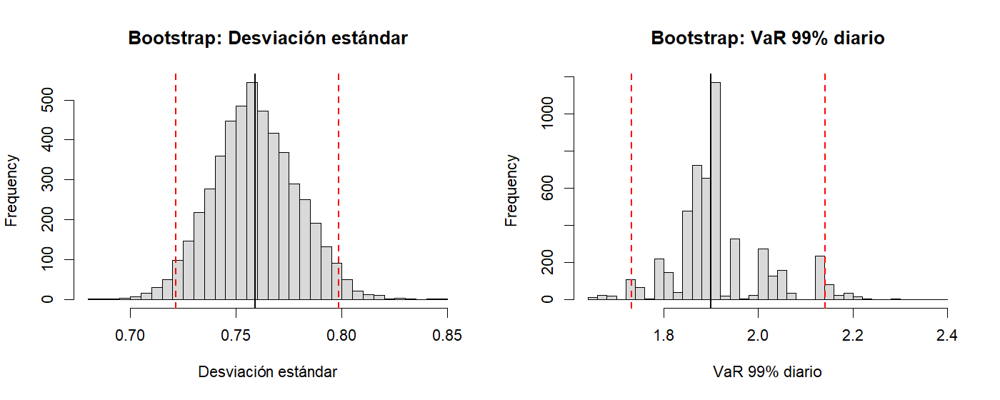
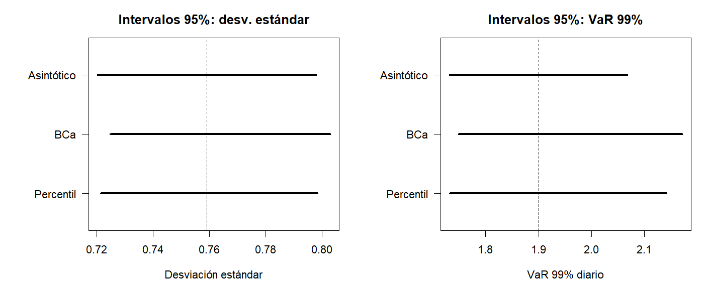
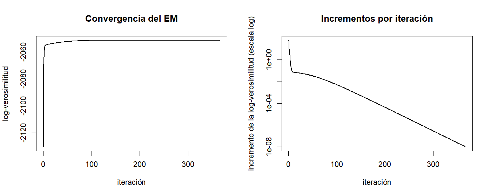
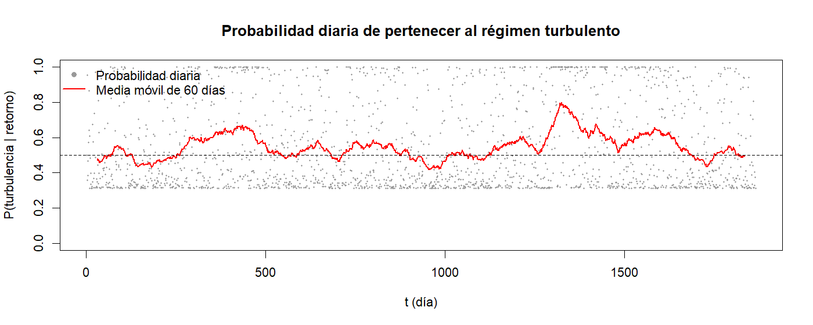
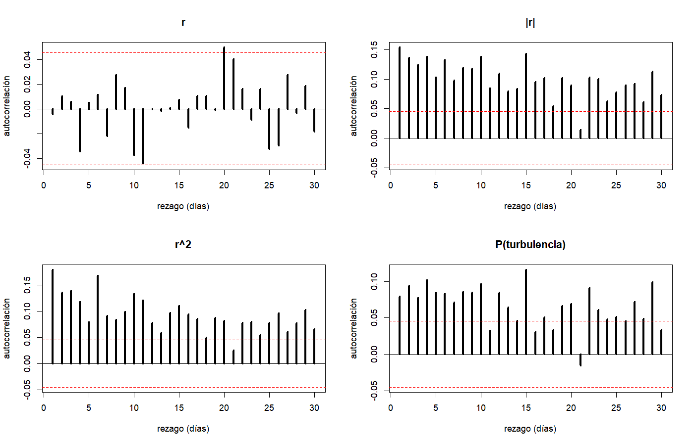
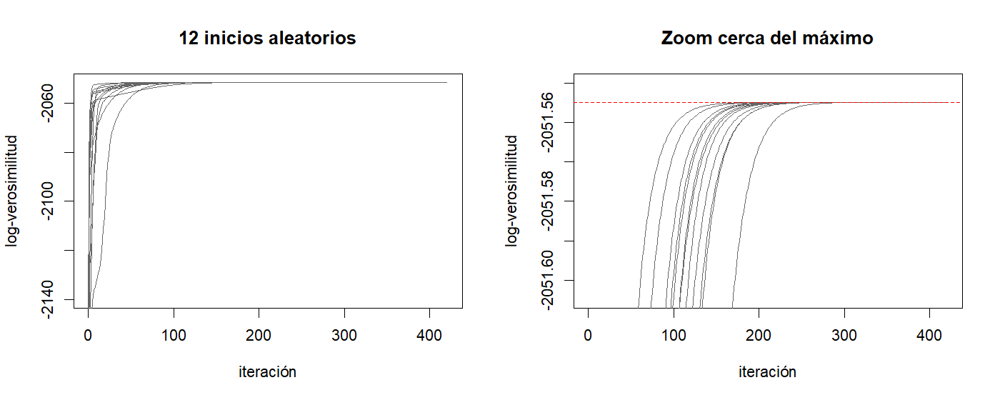

```{r setup, include=FALSE}
knitr::opts_chunk$set(echo = FALSE, message = FALSE, warning = FALSE,
                      fig.align = "center", out.width = "90%")
# Este archivo debe estar en la MISMA carpeta que 'resultados/' y 'figuras/' (creadas por los scripts 01-11).
if (!file.exists("resultados/params_A.rds")) {
  stop("No encuentro 'resultados/params_A.rds'. Carpeta de trabajo actual: ", getwd(),
       ". Copie este .Rmd a la carpeta donde ejecutó los scripts (la que contiene 'resultados' y 'figuras').")
}
# Todos los números del texto salen de los datos y de los resultados guardados por los scripts.
archivo <- "retornos_diarios_12_series.csv"
cand <- c(file.path("data", archivo), archivo)
ruta <- cand[file.exists(cand)][1]
datos <- read.csv(ruta, stringsAsFactors = FALSE, encoding = "UTF-8")
gbp <- datos[datos$serie == "GBP/USD", ]; gbp <- gbp[order(gbp$t), ]
r <- gbp$retorno_pct; n <- length(r)
n0 <- sum(r == 0); x <- abs(r[r != 0]); m <- length(x)
pA  <- readRDS("resultados/params_A.rds")
vA  <- readRDS("resultados/validacion_A.rds")
b1  <- readRDS("resultados/B1.rds")
b2  <- readRDS("resultados/B2.rds")
b2c <- readRDS("resultados/B2_completo.rds")
emb <- readRDS("resultados/EM_base.rds")
emi <- readRDS("resultados/EM_inicios.rds")
emf <- readRDS("resultados/EM_final.rds")
fd  <- readRDS("resultados/FaseD.rds")
f <- function(v, d = 4) formatC(v, format = "f", digits = d)
m2 <- mean((r - mean(r))^2)
asim <- mean((r - mean(r))^3) / m2^1.5
curt <- mean((r - mean(r))^4) / m2^2 - 3
t2 <- b2$tabla
# EM: convergencia lineal (razon de incrementos en las ultimas iteraciones)
rr <- emb$res; inc <- diff(rr$ll)
tasa <- (inc[length(inc)] / inc[200])^(1 / (length(inc) - 200))
# Probabilidad de turbulencia: media movil de 60 dias
pt <- emf$p_turb; w <- 60; cs <- cumsum(c(0, pt))
mm <- (cs[(w + 1):(n + 1)] - cs[1:(n - w + 1)]) / w
t_max_mm <- which.max(mm) + (w - 1) / 2
# Dias habiles del periodo (para acotar fechas)
bd <- seq(as.Date("1980-01-02"), as.Date("1987-05-21"), by = "day")
bd <- bd[as.integer(format(bd, "%u")) < 6]
```

# Introducción y datos

El proyecto estudia cuánto puede perderse en un día o en una semana al mantener un activo y qué tan confiable es esa cifra. Nuestro grupo trabaja con la serie del tipo de cambio **GBP/USD**, a partir del archivo `retornos_diarios_12_series.csv` entregado por la docente. Según la guía, la serie cubre del 2 de enero de 1980 al 21 de mayo de 1987 y su retorno diario es $100\,(\ln P_t-\ln P_{t-1})$, en porcentaje. El archivo no trae fechas, solo el número de día $t$; el período se toma de la guía. Se usan exclusivamente las `r n` observaciones de `GBP/USD`, que coinciden con las 1.866 que indica la guía, con $t$ consecutivo de 1 a `r n` y sin valores faltantes.

Los retornos tienen media `r f(mean(r))` y desviación estándar `r f(sd(r))`; su asimetría es `r f(asim)` y su curtosis en exceso es `r f(curt)`, lo que indica colas más pesadas que las de una normal. La Figura 1 muestra que los movimientos grandes tienden a agruparse en rachas, una señal de volatilidad agrupada que condiciona los supuestos de independencia de los métodos posteriores.

**Tratamiento de los ceros.** `r n0` retornos valen exactamente cero (`r f(100*n0/n, 3)` % de la serie). Las distribuciones Weibull y lognormal solo admiten valores estrictamente positivos, de modo que la Fase A se construye sobre $x_i=|r_i|$ para los $r_i\neq 0$, que son `r m` datos. Se excluyen solo para la Fase A. En B2 se usan los retornos originales completos, con los ceros. La consecuencia es que el modelo ajustado nunca produce un retorno exactamente cero, mientras que en los datos ocurre en el `r f(100*n0/n, 1)` % de los días. Esto es una limitación del modelo.

Además, el menor $|r|$ no nulo es `r f(min(x))`, y bajo la Weibull ajustada se esperarían unos `r round(m*(1-exp(-(min(x)/pA$lam_w)^pA$k_w)))` valores por debajo de ese mínimo, pero no hay ninguno. Esto es compatible con que los precios originales estén registrados en pasos discretos y que los movimientos muy pequeños figuren como cero; es solo una hipótesis, que no podemos verificar con los archivos disponibles.

```{r fig1, fig.cap="Retornos diarios de GBP/USD (izquierda) y variable de trabajo |r| sin ceros (derecha)."}

```

# Fase A: simulación y generación de variables

## Estimación por máxima verosimilitud

Se ajustaron por máxima verosimilitud, con implementación propia, la lognormal (solución cerrada: $\hat\mu=\overline{\ln x}$, $\hat\sigma^2=\overline{(\ln x-\hat\mu)^2}$) y la Weibull de forma $k$ y escala $\lambda$. Para la Weibull, $\hat\lambda^k=\overline{x^k}$ y la forma $\hat k$ es la raíz de
$$g(k)=\frac{\sum x_i^k\ln x_i}{\sum x_i^k}-\frac1k-\overline{\ln x}=0,$$
que se resolvió con el método de Newton. Como $g'(k)>0$ para todo $k>0$, la raíz es única. Newton convergió en pocas iteraciones desde varios valores iniciales. Como comprobación, `MASS::fitdistr` (solo verificación) coincide con nuestros parámetros hasta la quinta cifra decimal en la Weibull.

```{r tabA}
tabA <- data.frame(
  Familia = c("Lognormal", "Weibull"),
  Parametros = c(sprintf("mu = %s, sigma = %s", f(pA$mu_ln), f(pA$sigma_ln)),
                 sprintf("k = %s, lambda = %s", f(pA$k_w), f(pA$lam_w))),
  logLik = c(pA$ll_ln, pA$ll_w), AIC = c(pA$aic_ln, pA$aic_w))
knitr::kable(tabA, digits = 2, col.names = c("Familia", "Parámetros", "Log-verosimilitud", "AIC"),
             caption = "Parámetros estimados por máxima verosimilitud y AIC (m = 1791).")
```

La Weibull tiene un AIC menor en `r f(pA$aic_ln - pA$aic_w, 1)` unidades con el mismo número de parámetros, por lo que es la familia elegida para el resto del proyecto. Una forma $\hat k\approx1.14$, cercana a 1, implica una densidad que no cae a cero en el origen, como se observa en los datos (Figura 2).

## Generación y validación

La Weibull se simula por transformada inversa, $X=\lambda[-\ln U]^{1/k}$, y la lognormal con una normal estándar generada por Box-Muller, $X=\exp(\mu+\sigma Z)$ con $Z=\sqrt{-2\ln U_1}\cos(2\pi U_2)$. Solo se usa el generador uniforme base. Se comprobó que $F(X)$ es uniforme en la muestra Weibull y que Box-Muller reproduce media 0 y varianza 1 con muestras grandes. Para validar, se generó una muestra sintética 20 veces mayor que la real ($N=`r 20*m`$) por familia.

```{r fig2, fig.cap="Ajuste de las densidades con eje vertical logarítmico. Cada punto aislado en la cola corresponde a muy pocas observaciones."}

```

```{r fig3, fig.cap="Gráficos cuantil-cuantil: cuantiles observados frente a cuantiles de las muestras sintéticas (fila inferior: ejes logarítmicos)."}

```

```{r tabq}
tq <- vA$tabla_q
tq$p <- paste0(100 * tq$p, " %")
knitr::kable(tq, digits = 4,
  col.names = c("Cuantil", "Observado", "Weibull simulada", "Weibull teórica", "Lognormal simulada"),
  caption = "Cuantiles 50, 90 y 99 de |r|.")
```

La distancia de Kolmogorov-Smirnov, calculada manualmente entre la muestra observada y la sintética, es `r f(vA$D_w)` para la Weibull y `r f(vA$D_l)` para la lognormal (frente a la teórica, `r f(vA$D1_w)` y `r f(vA$D1_l)`). Como los parámetros se estimaron con los mismos datos, estos valores se interpretan como medidas de distancia y no como un contraste formal.

```{r cola}
q_t <- function(p) pA$lam_w * (-log(1 - p))^(1 / pA$k_w)
pp <- c(0.99, 0.995, 0.999)
cola <- data.frame(p = paste0(100 * pp, " %"), valor = q_t(pp),
                   obs = sapply(pp, function(p) sum(x > q_t(p))), esp = m * (1 - pp))
knitr::kable(cola, digits = c(0, 3, 0, 1),
  col.names = c("Cuantil de la Weibull", "Valor", "Datos que lo superan", "Esperados si el modelo fuera exacto"),
  caption = "Excedencias de la cola bajo el modelo Weibull.")
```

**Interpretación.** La Weibull sigue de cerca a los datos en el centro y hasta el cuantil 99 %, mientras que la lognormal, aunque tiene la cola teórica más pesada, la **sobreestima** con fuerza: su cuantil 99 % simulado es `r f(vA$tabla_q$lognormal_sint[3], 2)` frente a `r f(vA$tabla_q$observado[3], 2)` observado. Por otro lado, la Weibull subestima algo el extremo de la cola: en el último 0.5 % de los días hay más excedencias de las esperadas (Tabla 3), y el mayor retorno absoluto observado, `r f(max(x), 2)`, es muy poco probable bajo el modelo. Esto es relevante para el evento raro de B1.

**Retornos con signo.** Para simular retornos con signo se asigna $+$ o $-$ con probabilidad 1/2, independiente de la magnitud. Es un supuesto del modelo (simetría y signos independientes), no una propiedad demostrada de los datos: en la muestra hay `r sum(r>0)` retornos positivos y `r sum(r<0)` negativos.

# Fase B: integración y remuestreo

## B1: Monte Carlo y muestreo por importancia

Se estima $p=P(S_5>u)$, donde $S_5$ es la pérdida acumulada de 5 días consecutivos bajo el modelo de la Fase A (pérdidas diarias $s_jX_j$ independientes, con $X_j\sim$ Weibull y signos $\pm1$ equiprobables). Con una simulación de referencia de $4\times10^6$ réplicas se eligió $u=`r b1$u`$, el cuantil 99.9 % de $S_5$ redondeado, de modo que $p\approx0.1$ %. Una segunda simulación independiente de $4\times10^6$ réplicas da $p=`r f(b1$p_ref, 6)`$ (error estándar `r f(b1$se_ref, 6)`).

La propuesta de muestreo por importancia genera cada $X_j\sim$ Weibull$(k,\,c\lambda)$ con $c=`r b1$c_is`$ y declara un día como de pérdida con probabilidad $q=`r b1$q_is`$ en vez de 1/2. El peso es $W=\prod_{j=1}^5 c^{k}\exp\{-(x_j/\lambda)^k+(x_j/(c\lambda))^k\}\,(0.5/q)^{N_p}(0.5/(1-q))^{5-N_p}$, con $N_p$ el número de días de pérdida. El estimador es el promedio de $\mathbf 1\{S_5>u\}W$, insesgado porque $E_g[\mathbf 1\{S_5>u\}W]=p$. Los parámetros $(c,q)$ se eligieron con un piloto sobre una rejilla de propuestas.

```{r tabB1}
res <- b1$res
res$metodo <- c("Monte Carlo simple", "Muestreo por importancia", "Referencia (4e6)")
knitr::kable(res, digits = c(0, 6, 7),
  col.names = c("Método", "Estimación de p", "Error estándar"),
  caption = sprintf("Estimación de P(pérdida a 5 días > %s) con N = %d simulaciones por método.", b1$u, b1$N))
razon <- (res$error_estandar[1] / res$error_estandar[2])^2
```

La reducción de varianza lograda es de `r f(razon, 1)` veces: el muestreo por importancia con $N=`r b1$N`$ equivale a un Monte Carlo simple de unos `r format(round(razon * b1$N, -4), big.mark=".")` simulaciones. Ambas estimaciones son compatibles con la referencia (a menos de un error estándar de diferencia combinada).

```{r pil}
pil <- subset(b1$piloto, q %in% c(0.5, 0.85) & c %in% c(0.7, 1, 2, 4, 8))
knitr::kable(pil, digits = c(2, 2, 6, 2), row.names = FALSE,
  col.names = c("c", "q", "Estimación", "Var MC / Var IS"),
  caption = "Piloto de propuestas. Un cociente menor que 1 indica que la propuesta aumenta la varianza.")
```

El piloto ilustra por qué la propuesta debe elegirse con cuidado: con $c=0.7$ la varianza es mucho mayor que la del Monte Carlo simple, y con $c=8$ el cociente también cae por debajo de 1 (pesos muy dispersos). Limitación: el modelo supone días independientes, lo que contradice la volatilidad agrupada observada, y la Weibull subestima el extremo de la cola; la probabilidad real de una racha de pérdidas podría ser mayor que la del modelo.

## B2: remuestreo, jackknife e intervalos

Sobre los retornos originales, con los `r n0` ceros incluidos, se estudian la desviación estándar y el VaR al 99 % diario (cuantil 99 % de $-r$). Para cada estadístico se calcularon cuatro cosas, todas programadas a mano:

- **Bootstrap percentil** con $B=`r b2$B`$ réplicas (remuestreo con reemplazo con índices $\lfloor nU\rfloor+1$); el intervalo del 95 % toma los cuantiles 2.5 % y 97.5 % de las réplicas.
- **Jackknife** (dejar uno fuera): sesgo $(n-1)(\bar\theta_{(\cdot)}-\hat\theta)$ y error estándar $\sqrt{\tfrac{n-1}{n}\sum(\hat\theta_{(i)}-\bar\theta_{(\cdot)})^2}$.
- **Intervalo BCa**, que ajusta los niveles de los cuantiles bootstrap con una corrección de sesgo $z_0$ y una aceleración $a$; esta última se calcula con las réplicas jackknife de la muestra original, y no dentro del bootstrap.
- **Intervalo asintótico**: para la desviación estándar, el método delta, $\widehat{Var}(s)\approx(m_4-s^4)/(4s^2n)$; para el VaR, $\widehat{Var}(\hat q)\approx p(1-p)/(n f(q)^2)$ con la densidad $f$ estimada con un núcleo gaussiano y el ancho de banda de Silverman. Se evaluó la sensibilidad del resultado al ancho de banda.

```{r tabIC}
ic <- b2c$tab_ic
knitr::kable(ic, digits = 4, row.names = FALSE,
  col.names = c("Estadístico", "Método", "Límite inferior", "Límite superior", "Amplitud"),
  caption = "Intervalos de confianza del 95 % para la desviación estándar y el VaR al 99 %.")
```

```{r tabJK}
jk <- b2c$tab_jk
knitr::kable(jk, digits = c(0, 4, 5, 5, 4, 0), row.names = FALSE,
  col.names = c("Estadístico", "Estimación", "Sesgo jackknife", "EE jackknife", "Estimación corregida", "Valores distintos de las réplicas"),
  caption = "Jackknife: sesgo y error estándar.")
ee <- b2c$tab_ee
```

```{r tabEE}
knitr::kable(ee, digits = 4, row.names = FALSE,
  col.names = c("Estadístico", "Bootstrap", "Jackknife", "Asintótico"),
  caption = "Error estándar según el método.")
```

```{r fig4, fig.cap="Distribución bootstrap de la desviación estándar y del VaR 99 %. La línea negra es la estimación original y las rojas, el intervalo percentil."}

```

```{r fig5, fig.cap="Intervalos del 95 % por método (línea punteada: estimación original)."}

```

**Desviación estándar.** Los tres métodos coinciden: errores estándar de `r f(ee$bootstrap[1], 4)` (bootstrap), `r f(ee$jackknife[1], 4)` (jackknife) y `r f(ee$asintotico[1], 4)` (delta), e intervalos de amplitud casi igual. El sesgo es despreciable (`r f(jk$sesgo_jack[1], 5)` según el jackknife). El BCa se desplaza algo a la derecha porque $z_0>0$ y $a>0$, reflejo de la leve asimetría de la distribución bootstrap.

**VaR al 99 %.** Aquí los métodos se separan, y la diferencia tiene explicación:

- El **jackknife** subestima la variabilidad: el error estándar jackknife (`r f(ee$jackknife[2], 3)`) es menos de la mitad del bootstrap (`r f(ee$bootstrap[2], 3)`). Al quitar una observación, el cuantil solo puede tomar `r jk$valores_distintos[2]` valores distintos, lo cual es un caso conocido de inconsistencia del jackknife para estadísticos no suaves como los cuantiles. Por la misma razón, la aceleración $a$ del BCa (`r f(b2c$a["var"], 4)`) es poco confiable en este estadístico.
- El **intervalo asintótico** es simétrico y más corto (amplitud `r f(ic$amplitud[6], 3)` frente a `r f(ic$amplitud[4], 3)` del percentil), y no recoge la cola derecha larga de la distribución de pérdidas. Además, su error estándar depende del ancho de banda: entre `r f(min(b2c$sens$EE), 4)` y `r f(max(b2c$sens$EE), 4)` según el valor elegido.
- El **bootstrap percentil** produce una distribución irregular, con picos, porque el cuantil de una remuestra solo toma valores cercanos a las pérdidas observadas más grandes, entre las que hay huecos.

No hay un valor verdadero con el que decidir cuál método es el correcto para el VaR; se presentan las diferencias y su origen. Los sesgos estimados (jackknife `r f(jk$sesgo_jack[2], 4)`, bootstrap `r f(t2$sesgo_boot[2], 4)`) tienen signos opuestos y son pequeños frente al error estándar.

# Fase C: poblaciones ocultas con el algoritmo EM

## Modelo y algoritmo

Se supone que el retorno diario $r_i$ (con signo, incluidos los ceros) proviene de una mezcla de dos normales, un régimen de calma y otro de turbulencia: $f(r)=\pi\,\phi(r;\mu_1,\sigma_1)+(1-\pi)\,\phi(r;\mu_2,\sigma_2)$. El algoritmo EM, programado desde cero a partir del esqueleto de la docente, alterna dos pasos:

- **Paso E:** la responsabilidad del componente 1, $\gamma_i=\dfrac{\pi\,\phi(r_i;\mu_1,\sigma_1)}{\pi\,\phi(r_i;\mu_1,\sigma_1)+(1-\pi)\,\phi(r_i;\mu_2,\sigma_2)}$.
- **Paso M:** $\hat\pi=\tfrac1n\sum\gamma_i$, $\hat\mu_1=\sum\gamma_ir_i/\sum\gamma_i$, $\hat\sigma_1^2=\sum\gamma_i(r_i-\hat\mu_1)^2/\sum\gamma_i$, y lo análogo con $1-\gamma_i$ para el componente 2.

El paso M maximiza la esperanza de la log-verosimilitud completa respecto a las responsabilidades; esa es la razón de que la log-verosimilitud observada nunca disminuya. El criterio de parada es que el cambio absoluto de la log-verosimilitud entre dos iteraciones sea menor que $10^{-8}$. Antes de usar la serie real, se probó el código con datos simulados de parámetros conocidos (función `verificar_em()` de la docente): recuperó $\hat\pi=0.718$ y $\hat\sigma=(0.614,\,1.508)$, frente a los valores verdaderos 0.7 y $(0.6,\,1.5)$, en 193 iteraciones, con log-verosimilitud no decreciente.

```{r fig6, fig.cap="Convergencia del EM sobre GBP/USD: log-verosimilitud por iteración (izquierda) e incrementos en escala logarítmica (derecha)."}

```

Sobre la serie real, desde el inicio $\pi=0.7$, medias iguales a la media muestral y desviaciones $(0.5s,\,2s)$, el EM converge en `r rr$iter` iteraciones: la log-verosimilitud sube de `r f(rr$ll[1], 2)` a `r f(rr$ll[length(rr$ll)], 2)` y **nunca disminuye** (`r all(diff(rr$ll) >= -1e-9)`; el incremento mínimo es `r format(min(diff(rr$ll)), digits = 3)`). Casi toda la mejora ocurre en las primeras iteraciones; después los incrementos caen en línea recta en escala logarítmica, es decir, con convergencia lineal de tasa $\approx`r f(tasa, 3)`$ por iteración, lenta porque los dos regímenes se solapan mucho (medias casi iguales).

## Sensibilidad a la inicialización y a la tolerancia

```{r tabini}
ti <- emi$tab_ini[, c("inicio", "estado", "iter", "ll_final", "pi_calma", "sigma_calma", "sigma_turb")]
knitr::kable(ti, digits = c(0, 0, 0, 4, 4, 4, 4), row.names = FALSE,
  col.names = c("Inicio", "Estado", "Iteraciones", "Log-verosimilitud final", "pi (calma)", "sigma calma", "sigma turbulencia"),
  caption = "Doce inicios aleatorios (el componente 1 es el de menor desviación).")
```

Los `r sum(ti$estado == "convergió")` inicios convergieron, en `r min(ti$iter)` a `r max(ti$iter)` iteraciones, a la misma solución: la log-verosimilitud final difiere en menos de $10^{-3}$ entre ellos (`r f(min(ti$ll_final), 3)` a `r f(max(ti$ll_final), 3)`), y $\hat\pi$ varía entre `r f(min(ti$pi_calma), 4)` y `r f(max(ti$pi_calma), 4)`. Las pequeñas diferencias en la cuarta cifra reflejan el punto en que cada trayectoria se detuvo, no máximos distintos. En esta serie, la solución es robusta al valor inicial (figura en el Anexo).

```{r tabtol}
tt <- emi$tab_tol
tt$tol <- format(tt$tol, scientific = TRUE)
knitr::kable(tt, digits = c(0, 0, 6, 5, 5, 5), row.names = FALSE,
  col.names = c("Tolerancia", "Iteraciones", "Log-verosimilitud", "pi (calma)", "sigma calma", "sigma turbulencia"),
  caption = "Efecto de la tolerancia de parada (mismo inicio).")
```

Cada reducción de la tolerancia en un factor 100 cuesta unas 92 iteraciones, consistente con la convergencia lineal, pero entre $10^{-4}$ y $10^{-10}$ la log-verosimilitud cambia en menos de 0.003 mientras que $\hat\pi$ varía en `r f(max(tt$pi_calma) - min(tt$pi_calma), 4)`: la verosimilitud es muy plana respecto a $\pi$, de modo que una tolerancia laxa ya da prácticamente la misma respuesta.

```{r tabdeg}
dg <- emi$tab_deg
knitr::kable(dg, digits = c(0, 0, 0, 2, 6, 6), row.names = FALSE,
  col.names = c("Inicio", "Estado", "Iteración", "Última log-verosimilitud finita", "pi final", "sigma mínima final"),
  caption = "Casos degenerados.")
```

**Casos degenerados.** Con componentes idénticos el EM no puede separarlos: las responsabilidades son iguales para todos los datos, y el algoritmo se detiene en 2 iteraciones en la solución de una sola normal (log-verosimilitud `r f(dg$ll_ultima_finita[1], 2)`). Cuando un componente arranca muy estrecho, la desviación tiende a cero y la log-verosimilitud no está acotada. En el inicio "estrecho en 0, sigma = 0.01" el algoritmo colapsa en la iteración `r dg$iter[3]` con $\hat\pi=`r f(dg$pi_final[3], 5)`$, que es exactamente la proporción de ceros exactos (`r n0`/`r n` = `r f(n0/n, 5)`): un componente concentrado en 0 explica los `r n0` ceros repetidos con densidad que crece sin límite, y la log-verosimilitud sube a `r f(dg$ll_ultima_finita[3], 0)`, mucho más que la solución útil (`r f(rr$ll[length(rr$ll)], 0)`). En el inicio estrecho sobre el retorno máximo, $\hat\pi=1/`r n`$: el componente se queda con un solo dato. Por eso, al elegir entre inicios hay que descartar corridas con una desviación por debajo de un piso y no conservar simplemente la de mayor log-verosimilitud. Una desviación inicial algo mayor (0.03) ya conduce a la solución regular.

## Comparación con una sola normal y regímenes

```{r tabbic}
tb <- emf$tab_bic
knitr::kable(tb, digits = c(0, 0, 2, 2, 2), row.names = FALSE,
  col.names = c("Modelo", "Parámetros", "Log-verosimilitud", "AIC", "BIC"),
  caption = "Normal única frente a mezcla de dos normales.")
```

El BIC de la mezcla es `r f(tb$BIC[1] - tb$BIC[2], 1)` unidades menor que el de la normal única, de modo que la mezcla se prefiere con claridad aun con la penalización por sus tres parámetros adicionales. **No** se usó el contraste de razón de verosimilitud con una distribución $\chi^2$ (el estadístico vale `r f(2 * (tb$logLik[2] - tb$logLik[1]), 1)`), porque en mezclas no se cumplen las condiciones de regularidad: bajo la hipótesis nula de un solo componente, algunos parámetros no están identificados (si $\pi=1$ el segundo componente no importa; si los dos componentes coinciden, $\pi$ no importa) y la hipótesis está en la frontera del espacio de parámetros, por lo que la distribución límite no es una $\chi^2$ estándar. Una alternativa válida sería un bootstrap paramétrico de la razón de verosimilitud.

```{r tabreg}
tr <- emf$tab_reg
knitr::kable(tr, digits = 4, row.names = FALSE,
  col.names = c("Régimen", "Proporción", "Media", "Desviación"),
  caption = "Regímenes estimados por el EM (tolerancia 1e-10).")
pt <- emf$p_turb
cambios <- sum((pt[-1] > 0.5) != (pt[-n] > 0.5))
```

Los regímenes se distinguen por la **desviación** (`r f(tr$desviacion[1], 3)` frente a `r f(tr$desviacion[2], 3)`, unas `r f(tr$desviacion[2] / tr$desviacion[1], 1)` veces mayor) y no por la media, que en ambos casos es muy pequeña frente a su desviación. El régimen de turbulencia concentra el `r f(100 * tr$proporcion[2], 1)` % de los días (es el componente ancho de la mezcla). La probabilidad diaria de turbulencia supera 0.5 en `r sum(pt > 0.5)` días, 0.9 en `r sum(pt > 0.9)` y 0.99 en `r sum(pt > 0.99)`.

```{r fig8, fig.cap="Probabilidad diaria de pertenecer al régimen turbulento (puntos) y media móvil de 60 días (línea roja)."}

```

La media móvil de 60 días oscila entre `r f(min(mm), 2)` y `r f(max(mm), 2)` y alcanza su máximo cerca de $t\approx`r round(t_max_mm)`$, dentro de un conglomerado de días de alta probabilidad entre $t\approx1300$ y 1450. Sin embargo, el régimen no se separa en tramos largos y limpios: con corte 0.5 hay `r cambios` cambios día a día (racha media de `r f(n / (cambios + 1), 1)` días). La mezcla clasifica cada día solo por la magnitud de su retorno, sin mirar los días vecinos, y por eso no captura la persistencia; incluso un retorno exactamente cero tiene una probabilidad media de turbulencia de `r f(mean(pt[r == 0]), 2)`, porque el componente turbulento es ancho.

```{r tabcola}
tc <- emf$tab_cola
knitr::kable(tc, digits = c(0, 5, 3), row.names = FALSE,
  col.names = c("Fuente", "P(|r| > percentil 99)", "Razón frente a la observada"),
  caption = sprintf("Cola implicada: probabilidad de que |r| supere el percentil 99 de los datos (%s).", f(emf$q99, 3)))
```

**Cola implicada.** La mezcla y la Weibull reproducen la frecuencia observada de la cola (razones `r f(tc$razon_vs_observada[2], 2)` y `r f(tc$razon_vs_observada[3], 2)`), mientras que una normal única la subestima unas `r f(1 / tc$razon_vs_observada[5], 1)` veces. Es el beneficio concreto de la mezcla: dos escalas de volatilidad producen colas pesadas aunque cada componente sea normal. Esto no dice nada sobre el extremo más allá del 99 %.

# Fase D: interpretación y conclusiones

## 1. ¿El VaR al 99 % cambia según el modelo?

```{r tabvar}
tv <- fd$tab_var
knitr::kable(tv, digits = 3, row.names = FALSE,
  col.names = c("Nivel", "Empírico", "Normal", "Mezcla EM", "Weibull con signos", "Weibull con signos y ceros"),
  caption = "VaR diario (cuantil de la pérdida -r) por modelo.")
dd <- fd$dif
```

Sí cambia, y el supuesto que hace la diferencia es la **forma de la cola**. Al 95 % los modelos coinciden con el empírico. Al subir el nivel, la normal subestima el VaR (`r f(dd$normal[2], 1)` % al 99 %, `r f(dd$normal[3], 1)` % al 99.5 % y `r f(dd$normal[4], 1)` % al 99.9 %), porque sus colas son livianas, mientras que la mezcla (que combina dos escalas de volatilidad) y la Weibull se mantienen más cerca (la mezcla, `r f(dd$mezcla[2], 1)` % al 99 %). Dos advertencias: el VaR normal al 99 % (`r f(tv$normal[2], 3)`) cae dentro del intervalo percentil del VaR empírico (`r f(ic$inferior[4], 3)` a `r f(ic$superior[4], 3)`), de modo que a ese nivel la diferencia, por sí sola, no es estadísticamente clara (la evidencia más fuerte es la cola implicada, `r f(1 / tc$razon_vs_observada[5], 0)` veces menor bajo la normal); y el VaR empírico al 99.9 % depende de unas dos observaciones.

## 2. ¿La corrección de sesgo cambia alguna decisión?

No. Para la desviación estándar el sesgo es de `r f(jk$sesgo_jack[1], 5)` (jackknife) y `r f(t2$sesgo_boot[1], 5)` (bootstrap), frente a un error estándar de unos `r f(ee$bootstrap[1], 3)`: la corrección es del orden del 1 % del error estándar. Para el VaR, el jackknife sugiere `r f(jk$sesgo_jack[2], 3)` (estimación corregida `r f(jk$corregida[2], 3)`) y el bootstrap `r f(t2$sesgo_boot[2], 3)`, de signo contrario, ambos pequeños frente al error estándar (`r f(ee$asintotico[2], 3)` a `r f(ee$bootstrap[2], 3)`) y con un jackknife poco confiable para cuantiles. Que los dos estimadores apunten en direcciones opuestas indica que el sesgo del VaR no se estima de forma fiable, y que corregirlo no cambia la conclusión.

## 3. ¿Qué representan económicamente los dos componentes?

Los dos componentes son **dos niveles de volatilidad**: uno de movimientos pequeños (desviación `r f(tr$desviacion[1], 2)` %) y otro de movimientos grandes (`r f(tr$desviacion[2], 2)` %), con medias casi iguales. No representan una tendencia al alza o a la baja.

Para ubicar los días de mayor probabilidad de turbulencia en el tiempo hay una dificultad: el archivo trae solo el número de día $t$, no la fecha. El período tiene `r length(bd)` días hábiles y `r n` observaciones, es decir, faltan `r length(bd) - n`. Por tanto, el día $t$ ocurre, como pronto, en el $t$-ésimo día hábil desde el 2 de enero de 1980 y, como mucho, unas 12 semanas más tarde.

```{r tabtop}
bd <- seq(as.Date("1980-01-02"), as.Date("1987-05-21"), by = "day")
bd <- bd[as.integer(format(bd, "%u")) < 6]
top <- sort(order(-emf$p_turb)[1:15])
tp <- data.frame(t = top, fecha = format(bd[top], "%d/%m/%Y"), p = emf$p_turb[top])
knitr::kable(tp, digits = c(0, 0, 4), row.names = FALSE,
  col.names = c("Día t", "Fecha más temprana posible", "P(turbulencia)"),
  caption = "Los 15 días con mayor probabilidad de turbulencia y su fecha más temprana posible.")
```

Con lo verificado en fuentes, el conglomerado de $t\approx1300$ a 1450 (fechas más tempranas de diciembre de 1984 a julio de 1985), donde también está el máximo de la media móvil, es **compatible** con el episodio de debilidad de la libra de comienzos de 1985: la libra cayó cerca de un 20 % frente al dólar en 1984 desde su máximo de 1980 (2.45) y llegó a cotizar cerca de 1.10 en algunos mercados a comienzos de enero de 1985 (The Press, 7 de febrero de 1985); su mínimo histórico, de alrededor de 1.05 dólares, se registró el 26 de febrero de 1985 (CNBC, con datos de Refinitiv; otra fuente cita 1.042 con datos del Banco de Inglaterra); y en 1985 hubo una acción coordinada de bancos centrales para depreciar el dólar (acuerdo del Plaza). Como contexto, en julio de 1984 la libra había marcado un mínimo frente al dólar tras perder cerca de un 13 % desde marzo, y los cuatro grandes bancos británicos subieron sus tasas base en 2 puntos (nota de agencia, The Press, 13 de julio de 1984).

Esto **no** permite afirmar que cada día de la tabla corresponda a un evento concreto: sin fechas exactas la relación es aproximada. No se verificó ningún hecho de mercado para los días de 1981 ($t=287,\,416,\,426$) ni para el $t=1194$ (cuya fecha más temprana, el 30 de julio de 1984, es posterior al episodio de julio de 1984 citado), por lo que no se asocian a ninguno. La lectura económica prudente es que el componente de alta volatilidad reúne los días de movimientos grandes, y que sus rachas coinciden con períodos de fuerte presión sobre la libra, con un dólar muy fuerte, hasta la intervención coordinada de 1985. Contar con la serie fechada permitiría un cruce preciso.

## 4. ¿En qué supuestos fallan los intervalos y la mezcla?

```{r tabacf}
ta <- fd$tab_acf[c(1, 2, 3, 5, 10, 20, 30), ]
fuera <- sapply(fd$tab_acf[, -1], function(a) sum(abs(a) > fd$banda))
knitr::kable(ta, digits = 3, row.names = FALSE,
  col.names = c("Rezago", "r", "|r|", "r^2", "P(turbulencia)"),
  caption = sprintf("Autocorrelación muestral (banda de ruido blanco: +-%s).", f(fd$banda, 4)))
```

```{r fig9, fig.cap="Autocorrelación de r, |r|, r^2 y de la probabilidad de turbulencia (líneas rojas: banda de ruido blanco)."}

```

Los retornos con signo no están autocorrelacionados (`r fuera["r"]` de 30 rezagos fuera de la banda, lo esperable por azar), pero $|r|$ y $r^2$ sí, de forma positiva y persistente (`r fuera["|r|"]` y `r fuera["r^2"]` de 30 rezagos fuera de la banda; `r f(fd$tab_acf[["|r|"]][1], 2)` y `r f(fd$tab_acf[["r^2"]][1], 2)` en el rezago 1). La probabilidad de turbulencia hereda esa dependencia (`r fuera["P(turbulencia)"]` de 30 rezagos fuera). Es **volatilidad agrupada**: la dirección es impredecible, pero los días de movimiento grande tienden a seguirse. Esto viola el supuesto de independencia de las simulaciones de B1, del bootstrap ordinario y de la mezcla, que clasifica cada día de forma aislada. Una aproximación gruesa del efecto: con una ventana de Bartlett de 20 rezagos, el efecto de diseño es `r f(fd$efecto["abs"], 1)` para $|r|$ y `r f(fd$efecto["r2"], 1)` para $r^2$, lo que equivale a unos `r round(n / fd$efecto["r2"])` datos independientes en lugar de `r n`; los errores estándar de estadísticos basados en $r^2$, como la desviación estándar, podrían estar subestimados en un factor cercano a `r f(sqrt(fd$efecto["r2"]), 1)`. Es una estimación aproximada, no una corrección (la autocorrelación de $r^2$ con colas pesadas es ruidosa, y el efecto sobre un cuantil de cola puede ser distinto).

## 5. Si tuvieran una semana más

Se haría, en orden de prioridad: (1) un **bootstrap por bloques** (remuestrear tramos consecutivos de longitud fija) para medir cuánto crecen realmente los errores estándar de la desviación estándar y del VaR bajo dependencia; (2) un **modelo de cambio de régimen con cadena de Markov**, que da persistencia a los regímenes y evita que la clasificación salte día a día; (3) un **bootstrap paramétrico de la razón de verosimilitud** para contrastar formalmente una mezcla frente a una sola normal; y (4) conseguir la serie con fechas para cruzar los días turbulentos con hechos del mercado de forma precisa.

# Conclusiones y recomendaciones

- La **Weibull** ($\hat k=`r f(pA$k_w, 3)`$, $\hat\lambda=`r f(pA$lam_w, 3)`$) se prefiere a la lognormal por AIC (diferencia de `r f(pA$aic_ln - pA$aic_w, 0)`), por la distancia KS y por los cuantiles hasta el 99 %; subestima algo el último 0.5 % de la cola, que es la zona del evento raro de B1.
- El **muestreo por importancia** reduce la varianza del estimador de la pérdida a 5 días unas `r f(razon, 0)` veces (`r f(b1$u, 2)` es el umbral para $p\approx0.1$ %), y una propuesta mal escogida la aumenta.
- Para el VaR al 99 % (`r f(t2$estimacion[2], 2)`), los intervalos dependen del método y son anchos (percentil de `r f(ic$inferior[4], 2)` a `r f(ic$superior[4], 2)`): el estadístico es mucho menos preciso que la desviación estándar, y el jackknife no es fiable para cuantiles.
- La **mezcla de dos normales** supera a una sola normal (BIC menor en `r f(tb$BIC[1] - tb$BIC[2], 0)`), reproduce la cola observada y se obtiene de forma robusta desde distintos inicios, pero es sensible a colapsos de desviación (en esta serie, por los ceros exactos).
- Los **retornos no son independientes**: la autocorrelación de $|r|$ limita todos los intervalos y la propia mezcla. Se recomienda usar bootstrap por bloques y un modelo de cambio de régimen con cadena de Markov para cualquier uso de estos números más allá de lo académico.

# Referencias

- Arel-Bundock, V. *Rdatasets*. https://github.com/vincentarelbundock/Rdatasets (origen de los datos, según la guía del proyecto).
- Paquete de R `Ecdat` (divisas): [PENDIENTE: completar autor, año y versión con `citation("Ecdat")`, y la referencia original del conjunto `Garch` que aparece en `?Garch`].
- Nieto Gil, Y. (2026). *Guía del proyecto final, Computación Estadística 2026-II*. Universidad Nacional de Colombia.
- The Press (Christchurch). (7 de febrero de 1985). *The once-mighty pound sinks into feebleness*, p. 26. https://paperspast.natlib.govt.nz/newspapers/CHP19850207.2.134.1
- The Press (Christchurch). (13 de julio de 1984). Nota de agencia (PA, Londres) sobre el mínimo de la libra y el alza de tasas de los bancos. https://paperspast.natlib.govt.nz/newspapers/CHP19840713.2.69.9
- CNBC. (7 de septiembre de 2022). *British pound falls to its lowest level against the dollar since 1985*. https://www.cnbc.com/2022/09/07/british-pound-falls-to-its-lowest-level-against-the-dollar-since-1985.html
- LBC. (2022). *Run on the pound sparks speculation over emergency interest rate hike* (referencia a la acción coordinada de bancos centrales de 1985). https://lbc.co.uk/business/4b76efe7154f427fb4d481dbdfecbb0a
- Pound Sterling Live. *Odds for Pound to Dollar rate falls* (cita el mínimo de 1.042 según datos del Banco de Inglaterra). https://www.poundsterlinglive.com/usd/5546-odds-for-pound-to-dollar-rate-falls-betway
# Anexo

## Inicios aleatorios del EM

```{r fig7, fig.cap="Trayectorias de log-verosimilitud de los 12 inicios aleatorios (derecha: acercamiento cerca del máximo)."}

```

## Código

```{r anexo, results='asis'}
for (s in c("funciones_A.R", "funciones_EM.R", "01_datos.R", "02_mle.R", "03_generadores.R",
            "04_validacion.R", "05_B1.R", "06_B2.R", "07_B2_completo.R", "08_EM.R",
            "09_EM_inicios.R", "10_EM_interpretacion.R", "11_FaseD.R", "run_all.R")) {
  if (file.exists(s)) {
    cat("\n### ", s, "\n\n```r\n", paste(readLines(s, warn = FALSE), collapse = "\n"), "\n```\n", sep = "")
  }
}
```
